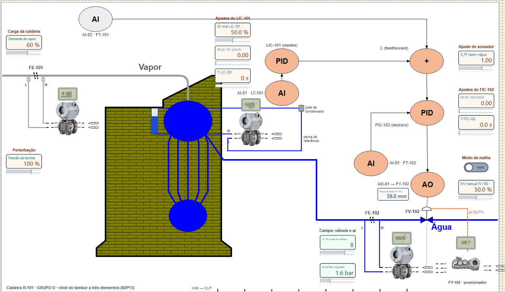
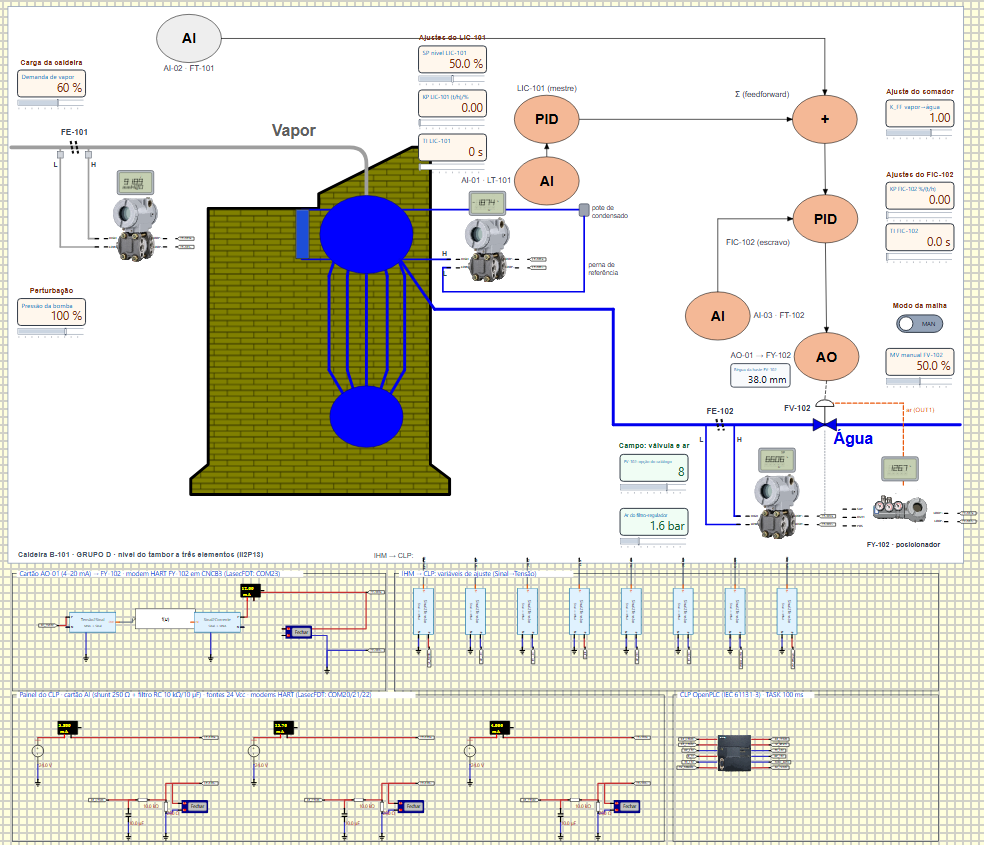
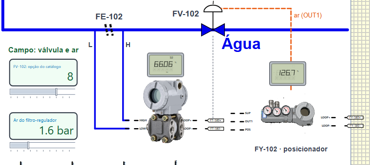
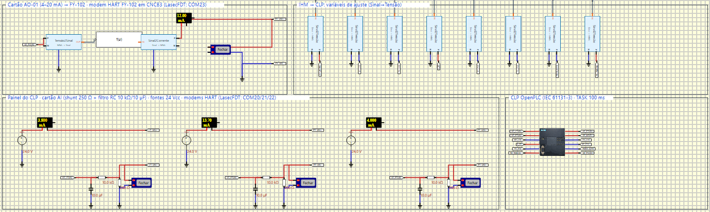
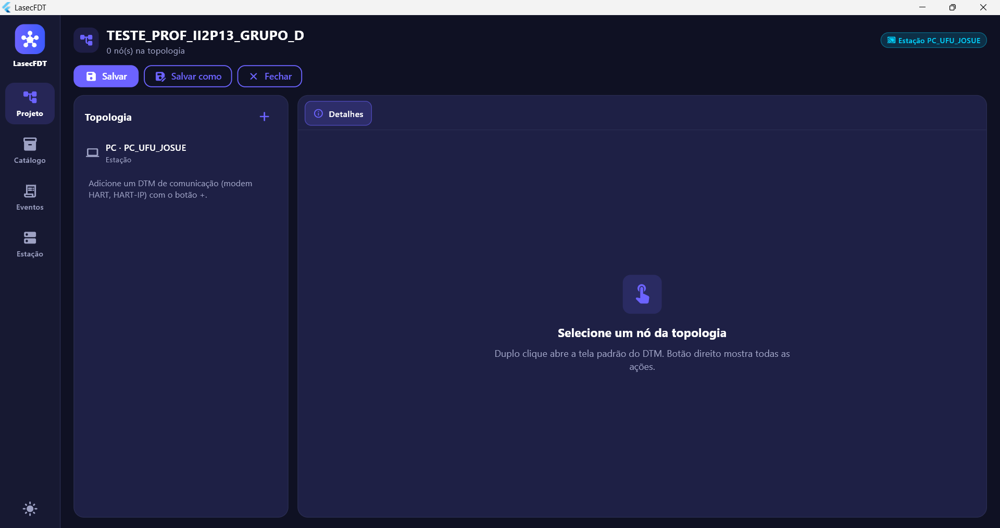
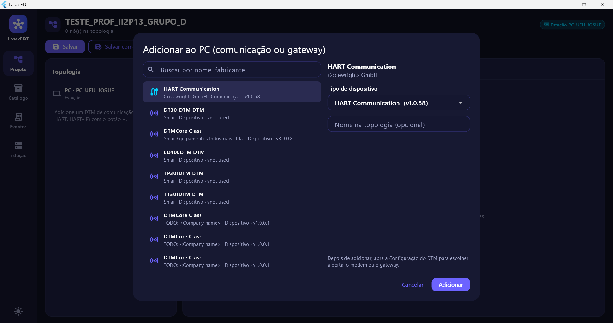
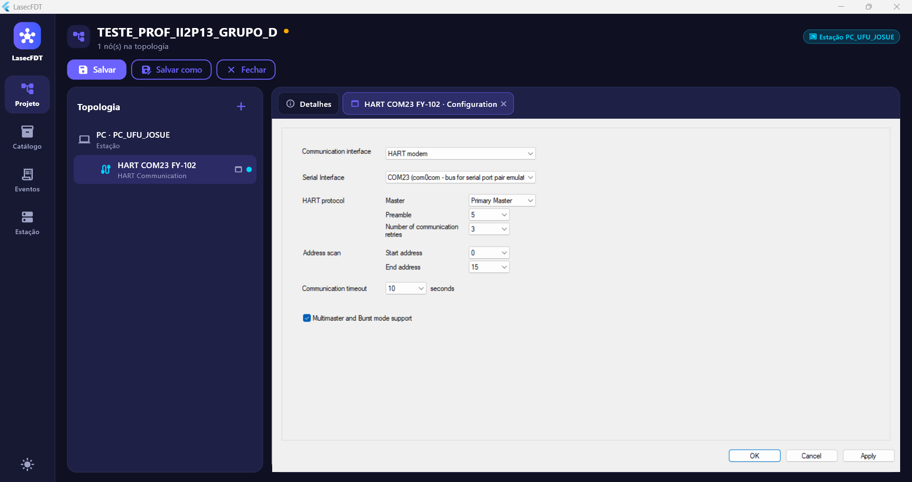
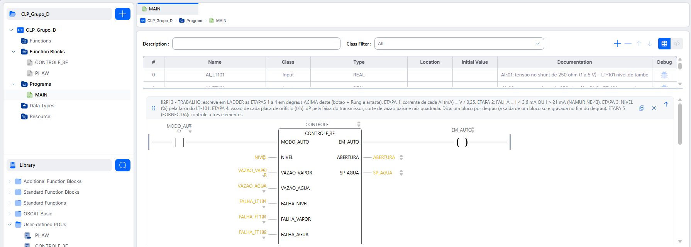

# Instrumentação Industrial II
## Aula Prática 13 — TRABALHO EM GRUPO: comissionamento de três LD301 e de um FY301, dimensionamento da válvula e Ladder das placas de orifício

A caldeira **B-101** acabou de ser montada. A tubulação, as tomadas de pressão, os três transmissores **SMAR LD301 (HART)**, a válvula de água de alimentação **FV-102** com o posicionador **SMAR FY301 (FY-102)** e o painel do **CLP** estão instalados e energizados, mas **nada foi comissionado**: os instrumentos vieram do almoxarifado com a configuração que tinham, a válvula montada é provisória, o filtro-regulador de ar não foi ajustado e o CLP só tem o programa que repassa a abertura manual da válvula.

Cada grupo recebe **uma caldeira diferente** (pressão, densidades, distância entre as tomadas, placas de orifício, bomba, atuador, posicionador). Os números da sua caldeira estão na **folha de dados do seu grupo** (`grupos/Grupo_X/FOLHA_DE_DADOS_GRUPO_X.md`). O roteiro abaixo é o mesmo para todos.

Ao final, a caldeira do seu grupo deve estar operando em **automático, com controle de nível a três elementos**, e tudo o que vocês fizeram tem de estar **salvo** nos dois arquivos do grupo (é com eles que o trabalho é corrigido, seção 11).

**Figura 1.** Sinótico da caldeira B-101 no LasecSimul (projeto de um grupo, como encontrado). À direita embaixo, a FV-102 com o posicionador FY-102 ligado ao atuador pela tubulação de ar (laranja) e o quadro verde *Campo: válvula e ar*.

---

## Índice

1. [O que o grupo tem de fazer e entregar](#1-o-que-o-grupo-tem-de-fazer-e-entregar)
2. [Arquivos, programas e portas](#2-arquivos-programas-e-portas)
3. [A planta no LasecSimul](#3-a-planta-no-lasecsimul)
4. [Parte A — Cálculos (antes de mexer em qualquer coisa)](#4-parte-a--cálculos-antes-de-mexer-em-qualquer-coisa)
5. [Parte B — Inspeção "como encontrado" pelo LasecFDT](#5-parte-b--inspeção-como-encontrado-pelo-lasecfdt)
6. [Parte C — Válvula, ar e posicionador FY-102](#6-parte-c--válvula-ar-e-posicionador-fy-102)
7. [Parte D — Os três LD301](#7-parte-d--os-três-ld301)
8. [Parte E — Ladder no CLP (OpenPLC do LasecSimul)](#8-parte-e--ladder-no-clp-openplc-do-lasecsimul)
9. [Parte F — Automático e ensaios](#9-parte-f--automático-e-ensaios)
10. [Problemas comuns](#10-problemas-comuns)
11. [Entrega e correção](#11-entrega-e-correção)
12. [Folhas de registro](#12-folhas-de-registro)

---

## 1. O que o grupo tem de fazer e entregar

1. **Calcular** (Parte A): a faixa do LT-101 (perna de referência úmida); a constante e a faixa de ΔP de cada placa de orifício; o Cv requerido da FV-102 e a válvula do catálogo; o suprimento de ar do posicionador.
2. **Configurar pelo LasecFDT** os três transmissores (LT-101, FT-101, FT-102) e o posicionador FY-102, registrando o "como encontrado" e o "como deixado".
3. **Ajustar no esquemático** a válvula instalada e o filtro-regulador de ar, e **conferir** no sinótico que a válvula abre o que vocês calcularam.
4. **Programar em Ladder** (editor OpenPLC dentro do LasecSimul) a corrente de cada canal, a validação dos sinais, o nível e **o cálculo das duas placas de orifício** (ΔP, corte e raiz quadrada).
5. **Colocar a malha em automático** e fazer os ensaios da Parte F.

**Entregáveis:** (1) a pasta `Grupo_X` com o `.lsproj` e o `.lsplc` **salvos**; (2) um relatório com a memória de cálculo da Parte A, as folhas da seção 12 preenchidas, as capturas da Parte F e as respostas às perguntas **❓**.

> **Segurança.** Isto é um exercício de instrumentação, não um procedimento para uma caldeira real: numa caldeira em serviço o nível muito baixo ou muito alto é protegido por um sistema de segurança independente (BMS/SIS), nunca pelo controle do CLP. Mesmo no simulador, siga a disciplina de campo: **malha em MANUAL antes de mexer num instrumento**.

---

## 2. Arquivos, programas e portas

| Arquivo (pasta `grupos/Grupo_X/`) | O que é |
|---|---|
| `II2P13_Grupo_X.lsproj` | o projeto do grupo: planta, transmissores e posicionador **como encontrados**, painel e CLP |
| `clp/CLP_Grupo_X.lsplc` | o projeto do CLP (editor OpenPLC) que vocês vão completar em **Ladder** |
| `FOLHA_DE_DADOS_GRUPO_X.md` | os dados de processo da caldeira do grupo |

Programas: **VS Code com a extensão LasecSimul 0.0.111 ou mais nova** (versões anteriores não guardam no projeto a calibração do FY301 nem os ajustes feitos no sinótico) e o **LasecFDT** (DTMs SMAR LD301 e SMAR FY301 e o DTM de comunicação *HART Communication* da CodeWrights). O PACTware funciona do mesmo jeito, com os mesmos DTMs.

Cada grupo trabalha num PC. Os modems HART do painel usam pares virtuais do **com0com**:

| Instrumento | Modem no esquemático | Porta no LasecFDT |
|---|---|---|
| LT-101 | `CNCB0` | `COM20` |
| FT-101 | `CNCB1` | `COM21` |
| FT-102 | `CNCB2` | `COM22` |
| FY-102 (FY301) | `CNCB3` | `COM23` |

Se o PC tiver outro mapeamento, pare a simulação, selecione o modem e escolha em *Porta serial* a ponta `CNCBx` de um par livre; o LasecFDT usa a outra ponta do mesmo par.

**Como abrir:** abra a pasta `Grupo_X` no VS Code, dê dois cliques em `II2P13_Grupo_X.lsproj`, use **Zoom to fit all** e clique em **Run simulation** (▶). Na primeira vez o LasecSimul compila o programa do CLP (alguns segundos; acompanhe em *LasecSimul: Simulação*, no painel Output). Os modems abrem as portas sozinhos quando a simulação começa.

---

## 3. A planta no LasecSimul

O sinótico é a tela de operação da caldeira: caldeira de alvenaria com tambor de vapor e tambor de lama, linha de vapor (cinza) com a placa **FE-101** e o **FT-101**, visor de nível **LG-101** (barra azul ao lado do tambor), **LT-101** com a perna de referência que desce do pote de condensado, linha de água (azul) com a placa **FE-102**, o **FT-102**, a válvula **FV-102** e, logo abaixo dela, o posicionador **FY-102** ligado ao atuador pela tubulação de ar (laranja, OUT1). À direita, o diagrama do controle (AI, PID, Σ, PID, AO).

| No sinótico | Para quê |
|---|---|
| Caixas laranja (valor + slider) | **IHM**: demanda de vapor, pressão da bomba, SP/KP/TI do LIC-101, K_FF, KP/TI do FIC-102, MV manual |
| Alternador MAN/AUTO | modo da malha |
| Quadro verde **Campo: válvula e ar** | **FV-102: opção do catálogo** (a válvula instalada) e **Ar do filtro-regulador** (bar) — são ajustes de campo, feitos com a malha em MANUAL |
| **Régua da haste FV-102** | indicação mecânica do curso da haste em mm (como a régua presa na válvula) |
| LCD de cada LD301 e do FY301 | o que o instrumento mostra |

Tudo o mais (correntes, ΔP, vazões em t/h, nível em %) vocês medem com o LasecFDT, com os amperímetros do painel e com o Debugger do CLP.

**Figura 2.** O projeto inteiro: sinótico em cima e painel embaixo (cartão AO-01 → FY-102, conversores IHM → CLP, cartão AI com os três laços e o CLP).

**Figura 3.** Campo da FV-102: placa FE-102 e FT-102, quadro verde com a válvula instalada (opção do catálogo) e o ar do filtro-regulador, régua da haste e o FY-102 (LCD com a posição em %).

### 3.1 Por que três elementos

O nível do tambor obedece ao balanço de massa: **água que entra − vapor que sai − purga**. Um controlador que só olha o nível reage tarde e é enganado pelo **inchamento (swell)**: quando a demanda de vapor sobe, a pressão do tambor cai, as bolhas crescem e o nível **sobe** por alguns segundos, embora esteja saindo mais água do que entrando; o controlador de um elemento fecha a água, no sentido errado.

- **Vazão de vapor (FT-101), antecipação:** a água que vai faltar é conhecida assim que o vapor muda: `K_FF × vazão de vapor` entra no setpoint da água antes de o nível se mexer.
- **Nível (LT-101), correção:** o mestre **LIC-101** corrige o que a antecipação não acerta (purga, erros de medição), com uma correção limitada, em t/h.
- **Vazão de água (FT-102), malha escrava:** o **FIC-102** faz a vazão de água seguir o setpoint e rejeita as perturbações do lado da água (pressão da bomba) antes que virem erro de nível.

### 3.2 O painel

Cada transmissor tem o seu laço: fonte de 24 Vcc → amperímetro → LD301 → **shunt de 250 Ω do cartão AI** → 0 V; o CLP lê a tensão do shunt por um filtro RC (10 kΩ/10 µF), e o modem HART fica **em paralelo com o shunt**. O posicionador é diferente: quem impõe a corrente é o **cartão AO-01** (uma fonte de corrente 4–20 mA comandada pelo CLP); o FY301 é uma **carga** alimentada pelo laço (~550 Ω) e responde HART variando a tensão nos seus bornes, por isso o modem do FY-102 fica em paralelo com os bornes do posicionador.

**Figura 4.** Painel do CLP. Em cima à esquerda, o cartão AO-01 (o valor da saída do CLP vira uma fonte de corrente) e o modem HART do FY-102; embaixo, os três laços AI (fonte 24 V, amperímetro, shunt de 250 Ω, filtro RC e modem HART em paralelo com o shunt) e o CLP. Os amperímetros já dizem muito: nesta caldeira, como encontrada, um transmissor está saturado em 3,8 mA e outro preso em 4,0 mA.

| Pino do CLP | Origem / destino | Sinal no simulador |
|---|---|---|
| `AI_LT101`, `AI_FT101`, `AI_FT102` | AI-01/02/03 | tensão no shunt: 1,00 V (4 mA) a 5,00 V (20 mA) |
| `SP_NIVEL`, `KP_LIC`, `TI_LIC`, `K_FF`, `KP_FIC`, `TI_FIC`, `MV_MANUAL` | IHM | valor numérico do ajuste |
| `MODO_AUTO` | IHM | FALSE = manual, TRUE = automático |
| `AO_FV102` | AO-01 → FY-102 | valor numérico em **mA** (4,0 = fechada, 20,0 = aberta) |

❓ **1.** Por que o modem do LD301 fica em paralelo com o shunt e o do FY301 em paralelo com o posicionador? Por que um modem em **série** com o FY301 não conseguiria conversar com ele?

---

## 4. Parte A — Cálculos (antes de mexer em qualquer coisa)

Use a folha de dados do grupo. Mostre as contas no relatório.

### 4.1 Faixa do LT-101 (perna de referência úmida)

HIGH na tomada inferior (perna variável: água do tambor até o nível *h*, vapor acima), LOW na perna de referência, sempre cheia de condensado até a tomada superior. Os trechos abaixo da tomada inferior existem nas duas pernas e se cancelam.

$$\Delta P(h) = 1000\,[\,SG_a\,h + SG_v\,(H - h) - SG_c\,H\,] \quad \text{mmH}_2\text{O}, \qquad SG = \rho/998{,}2$$

- **LRV** = ΔP com nível 0 % (*h* = 0) — será negativo;
- **URV** = ΔP com nível 100 % (*h* = *H*) — também negativo, mas maior que o LRV.

❓ **2.** Por que as duas faixas são negativas? O que mostraria o LT-101 se fosse calibrado "a frio" (água a 20 °C no tambor)? E se o pote de condensado secasse?

### 4.2 Placas de orifício FE-101 e FE-102

Da equação da folha de dados, com ΔP em mmH2O (1 mmH2O = 9,789 Pa) e *q* em t/h (1 kg/s = 3,6 t/h):

$$q\,[\text{t/h}] = K\,\sqrt{\Delta P\,[\text{mmH}_2\text{O}]}, \qquad K = 3{,}6\,\frac{C}{\sqrt{1-\beta^4}}\,\varepsilon\,\frac{\pi}{4}d^2\sqrt{2\,\rho \cdot 9{,}789}, \qquad \beta = d/D$$

Para cada placa calcule β, *K* e o **URV do transmissor** = ΔP no fundo de escala = (q_max/K)². O LRV é 0.

❓ **3.** Com o transmissor linear em ΔP, qual corrente corresponde a 50 % da vazão máxima? E a 10 %? Por que se usa um **corte de vazão baixa** antes da raiz?

### 4.3 Válvula FV-102

1. Para as três condições da folha (mínima, normal, máxima) calcule ΔP = p1 − p2, a vazão em m³/h, **Kv** e **Cv**.
2. Para cada opção do catálogo **com a característica pedida** (e disponível no almoxarifado), calcule a abertura nas três condições.
3. Escolha a **menor** válvula que fica entre **20 % e 85 %** nas três condições.
4. Calcule a abertura prevista na condição inicial de operação (demanda de 60 % da MCR + purga). Ela será conferida na régua da haste na Parte C.

❓ **4.** Por que a queda na válvula (p1 − p2) diminui quando a vazão aumenta? O que isso faz com a característica **instalada** de uma válvula linear?

### 4.4 Ar do posicionador

O suprimento tem de vencer a mola inteira com folga: **≥ fim da faixa da mola + 0,4 bar** (e ≤ 6 bar). Compare com o que o filtro-regulador mostra no sinótico.

---

## 5. Parte B — Inspeção "como encontrado" pelo LasecFDT

Com a simulação rodando e a malha em **MANUAL**:

> Em algumas caldeiras a FV-102 pode **não obedecer** ao MV manual logo de início e o tambor encher ou esvaziar em poucos minutos — é um dos defeitos "como encontrado". Anote o que acontece (régua da haste, nível no LG-101), **pause** a simulação se precisar e resolva primeiro a Parte C (válvula, ar e posicionador); depois volte aos transmissores com o nível de novo perto de 50 % (MV manual).

1. Observe o sinótico: nível no LG-101, LCD de cada LD301 e do FY301, régua da haste, amperímetros do painel. Anote tudo na Folha 1.
2. No **LasecFDT**, monte o projeto do grupo: **PC → HART Communication (CodeWrights)** numa porta COM → instrumento. Use uma comunicação por instrumento: `COM20` (LT-101), `COM21` (FT-101), `COM22` (FT-102) e `COM23` (FY-102). Procure o instrumento (endereços 0 a 15 — um deles **não** está no endereço 0) e associe o DTM certo (**SMAR LD301** ou **SMAR FY301**).

   

   **Figura 5.** LasecFDT: **Novo projeto** cria a topologia com o PC da estação; o botão **+** da topologia adiciona a comunicação.

   

   **Figura 6.** Adicione **HART Communication (Codewrights GmbH)**, uma por porta, e dê um nome que diga o instrumento (ex.: "HART COM23 FY-102").

   

   **Figura 7.** **Abrir tela** da comunicação: *Serial Interface* = a porta do instrumento (COM20 a COM23), *Communication timeout* = **10 s** (no simulador o HART é mais lento que o real) e, só para procurar um instrumento fora do endereço 0, *End address* = 15 (a busca de 0 a 15 leva alguns minutos). **OK**, depois **Buscar instrumentos**.
3. Para cada instrumento, leia **online** e registre na Folha 1: tag, descritor, mensagem, endereço de polling, faixa (LRV/URV), unidade, função de transferência, amortecimento; no FY301, AIR_T, ação, caracterização, TSO e TIME.

❓ **5.** Para cada instrumento, liste o que está errado para o serviço na caldeira e o efeito disso na malha (por exemplo: um transmissor em endereço diferente de 0 com a corrente presa em 4 mA; raiz quadrada habilitada no transmissor **e** no CLP).

---

## 6. Parte C — Válvula, ar e posicionador FY-102

Malha em **MANUAL**. Primeiro o mecânico, depois o posicionador:

1. **Válvula:** no quadro verde do sinótico, ponha em *FV-102: opção do catálogo* a válvula escolhida na Parte A.
2. **Ar:** ajuste *Ar do filtro-regulador* para o valor calculado na seção 4.4.
3. **FY301 pelo LasecFDT (COM23):**
   - tag **FY-102**, descritor e mensagem;
   - **AIR_T** (ar para abrir = *Open*, ar para fechar = *Close*) conforme o atuador do grupo, ação **direta** (*Direct*): no CLP de todos os grupos, **4 mA = fechada e 20 mA = aberta**;
   - **caracterização**, **TSO** e **TIME** conforme os requisitos da folha de dados;
   - **Auto Setup** (cerca de 1 min no simulador): o FY301 tira todo o ar, grava a posição de repouso, aplica ar total e grava a outra ponta. Antes dele o posicionador usa a escala de fábrica do sensor (30 mm), que não é o curso da sua válvula. Só faça o Auto Setup **depois** de acertar o ar: com ar insuficiente ele grava um curso menor que o real.
4. **Conferência:** com o MV manual em 0 %, 25 %, 50 %, 75 % e 100 %, anote a corrente no amperímetro da AO-01, a posição no LCD do FY301 e a **régua da haste** (mm). A haste tem de ir de 0 ao curso total e ser proporcional ao sinal (ou seguir a curva pedida). Na Folha 2, compare a abertura na condição inicial com a prevista na Parte A.

❓ **6.** Se o grupo tem atuador **ar para fechar**, o que acontece com o AIR_T de fábrica (*Open*)? Explique pelo sentido da realimentação do servo do posicionador.

❓ **7.** Em que posição a FV-102 do seu grupo vai se perder o ar ou o sinal? Isso é seguro para o tambor? Qual é o argumento a favor de cada escolha (falha aberta × falha fechada) numa caldeira?

---

## 7. Parte D — Os três LD301

Malha em **MANUAL**. Para cada transmissor, pelo LasecFDT:

1. Tag (`LT-101`, `FT-101`, `FT-102`), descritor e mensagem.
2. **Endereço de polling 0** (laço ponto a ponto, corrente 4–20 mA ativa).
3. Unidade **mmH2O** (não mude a unidade: deixe mmH2O, que é a unidade da folha de dados).
4. **LRV e URV** calculados na Parte A.
5. Função de transferência **linear** (a raiz quadrada é feita no CLP, Parte E).
6. Amortecimento: 1 s no LT-101, 0,5 s nos FT.
7. **Teste de malha** (corrente fixa 4, 12 e 20 mA): confira o amperímetro do painel e a tensão no shunt; saia do teste de malha ao terminar.

Depois de configurar, confira com a planta (Folha 3): o LT-101 tem de indicar o mesmo nível do visor LG-101; as correntes dos FT, o ΔP das placas com as vazões da condição inicial.

> **Salve com frequência.** O LasecSimul copia a configuração dos instrumentos para o `.lsproj` quando a simulação é **parada** e quando o projeto é **salvo** (Ctrl+S). Pausar não perde nada; fechar o VS Code sem salvar perde.

---

## 8. Parte E — Ladder no CLP (OpenPLC do LasecSimul)

Abra `clp/CLP_Grupo_X.lsplc` (duplo clique): abre o editor OpenPLC dentro do LasecSimul. O projeto tem:

- `PI_AW` e `CONTROLE_3E` (Structured Text, **fornecidos, não altere**): o controle a três elementos inteiro (mestre LIC-101, feedforward, escravo FIC-102, partida sem salto, anti-windup);
- `MAIN` (**Ladder**): já traz o degrau da ETAPA 5 (chamada do `CONTROLE_3E`) e os degraus da ETAPA 6 (saída AO = 4 + 0,16 × ABERTURA). As variáveis que o `CONTROLE_3E` usa já estão declaradas.

O grupo escreve em **Ladder**, em degraus **acima** do degrau da ETAPA 5:

**Figura 8.** O `MAIN` do modelo no editor OpenPLC do LasecSimul: o comentário do primeiro degrau resume as etapas; o degrau mostrado é a ETAPA 5 (contato MODO_AUTO → bloco CONTROLE_3E → bobina EM_AUTO).

| Etapa | O que calcular | Variáveis (já declaradas) |
|---|---|---|
| 1 | corrente de cada canal: I (mA) = V / 0,25 | crie `I_LT101`, `I_FT101`, `I_FT102` |
| 2 | validação NAMUR NE 43: falha se I < 3,6 mA **ou** I > 21 mA (blocos `LT`/`GT` e contatos em paralelo numa bobina) | `FALHA_LT101`, `FALHA_FT101`, `FALHA_FT102` |
| 3 | nível (%) pela faixa do LT-101: 4 mA = 0 %, 20 mA = 100 % | `NIVEL` |
| 4 | **cada placa de orifício**: ΔP (mmH2O) = (I − 4)/16 × URV; ΔP negativo = 0; abaixo do corte (1 % do URV) vazão = 0; senão q = K·√ΔP (t/h) | `VAZAO_VAPOR`, `VAZAO_AGUA` (crie as intermediárias) |

Preencha também o valor inicial de `QMAX_AGUA` (fundo de escala do FT-102, t/h).

Dicas do editor:

- blocos de função em **Ladder**: `DIV`, `SUB`, `MUL`, `ADD`, `SQRT`, `MAX`, `LT`, `GT`, `MOVE` (biblioteca, arraste para o degrau); ligue variáveis e constantes nas entradas e uma variável na saída `OUT`;
- **um bloco por degrau**: a saída de um bloco só é gravada na variável no fim do degrau; dois blocos encadeados no mesmo degrau fazem o segundo usar o valor do ciclo anterior;
- condição de um cálculo (por exemplo "só tira a raiz se não está no corte"): um **contato** (normal ou negado) antes do bloco, na entrada EN.

**Conferência (malha em MANUAL):** compile, rode a simulação e use o **Debugger** do editor: `NIVEL`, `VAZAO_VAPOR` e `VAZAO_AGUA` têm de bater com o LG-101 e com as vazões que vocês calcularam a partir das correntes (Folha 3). Force uma entrada analógica abaixo de 0,9 V e confira a falha.

❓ **8.** Por que a raiz quadrada fica num só lugar? O que acontece com a vazão medida se o FT estiver com a função raiz **e** o CLP também tirar a raiz?

---

## 9. Parte F — Automático e ensaios

1. Ajuste na IHM a sintonia da folha de dados (SP, KP/TI do LIC-101, K_FF, KP/TI do FIC-102).
2. Passe para **AUTO**. O CLP só entra em automático depois de 10 s em RUN e sem falha no LT-101 e no FT-102.
3. Ensaios (capture o sinótico e o comportamento do nível; o editor do CLP tem gráficos no Debugger):
   - **degrau de carga:** demanda de vapor de 60 % para 80 % e de volta para 60 %;
   - **pressão da bomba:** de 100 % para 85 %;
   - **sem antecipação:** K_FF = 0 e repita o degrau de carga.

❓ **9.** No degrau de carga, o nível primeiro sobe ou desce? Por quê? Compare com K_FF = 0.

❓ **10.** Na queda de pressão da bomba, quem corrige primeiro: o mestre de nível ou o escravo de vazão? Como isso aparece na régua da haste?

Ao terminar, **deixe a malha em AUTO**, pare a simulação e **salve** (Ctrl+S) o projeto e o projeto do CLP.

---

## 10. Problemas comuns

| Sintoma | Causa provável |
|---|---|
| O LasecFDT não acha o instrumento | simulação parada; porta errada; o modem do esquemático está em outra porta; o instrumento não está no endereço 0 (procure 0 a 15) |
| "SetCommunication… FALSE" ao conectar, ou a porta parece ocupada | uma sessão anterior do LasecFDT ficou aberta: feche o LasecFDT pelo botão da janela (não pelo Gerenciador de Tarefas) e abra de novo; se persistir, peça ao professor para encerrar os processos `CWFdtHARTPort.exe`/`CWFdtDrvMan.EXE` |
| Válvula vai sozinha a um extremo e não obedece ao sinal | AIR_T trocado para o tipo de atuador (realimentação positiva do servo) |
| Válvula não chega a 100 % (ou não fecha) | suprimento de ar abaixo do fim da faixa da mola |
| Posição do FY301 não bate com a régua | Auto Setup não feito (escala de fábrica de 30 mm) ou feito com ar insuficiente |
| Vazão no CLP muito baixa e "achatada" | raiz quadrada no transmissor **e** no CLP |
| FT preso em 4 mA | endereço de polling diferente de 0 |
| Valor no CLP "atrasado" um ciclo | dois blocos encadeados no mesmo degrau |
| Mudei a unidade do LD301 e o valor não mudou | no simulador a unidade do LD301 só troca o código; deixe em mmH2O |

---

## 11. Entrega e correção

Entregue a pasta `Grupo_X` inteira (com `II2P13_Grupo_X.lsproj` e `clp/CLP_Grupo_X.lsplc`) e o relatório. A correção automática lê os dois arquivos:

| O que é conferido | Onde fica salvo |
|---|---|
| tag, endereço, LRV/URV, unidade, função e amortecimento de cada LD301 | `.lsproj` (configuração HART escrita pelo LasecFDT) |
| tag, AIR_T, ação, caracterização, TSO/TIME e a **calibração do Auto Setup** do FY301 | `.lsproj` |
| válvula instalada e suprimento de ar | `.lsproj` (quadro verde do sinótico) |
| sintonia e modo da IHM | `.lsproj` |
| MAIN em Ladder, nível, vazões das duas placas, falhas e saída AO, testados com correntes conhecidas | `.lsplc` |
| comportamento em automático com degrau de carga (opcional) | os dois |

A memória de cálculo, as folhas de registro e as respostas ❓ são corrigidas pelo relatório.

---

## 12. Folhas de registro

### Folha 1 — Como encontrado

| Item | LT-101 | FT-101 | FT-102 | FY-102 |
|---|---|---|---|---|
| Endereço de polling | | | | |
| Tag / descritor | | | | |
| LRV / URV (unidade) | | | | — |
| Função de transferência | | | | — |
| Amortecimento | | | | — |
| AIR_T / ação / curva / TSO / TIME | — | — | — | |
| Corrente no painel (mA) | | | | |
| Problemas encontrados | | | | |

Válvula instalada (opção): ______ · Suprimento de ar: ______ bar · Régua da haste com MV = ____ %: ______ mm

### Folha 2 — Válvula e posicionador

| MV manual (%) | AO-01 (mA) | FY301 posição (%) | Régua da haste (mm) | Abertura (%) |
|---|---|---|---|---|
| 0 | | | | |
| 25 | | | | |
| 50 | | | | |
| 75 | | | | |
| 100 | | | | |

Abertura prevista na condição inicial (Parte A): ______ % · medida: ______ %

### Folha 3 — Transmissores comissionados e conferência no CLP

| Item | LT-101 | FT-101 | FT-102 |
|---|---|---|---|
| LRV / URV como deixado | | | |
| Corrente no painel (mA) | | | |
| Valor de processo esperado (nível % / t/h) | | | |
| Valor no CLP (`NIVEL`, `VAZAO_VAPOR`, `VAZAO_AGUA`) | | | |

### Folha 4 — Ensaios

| Ensaio | Pico/vale do nível | Tempo para voltar ao SP (±2 %) | Observações |
|---|---|---|---|
| Carga 60 → 80 % | | | |
| Carga 80 → 60 % | | | |
| Bomba 100 → 85 % | | | |
| Carga 60 → 80 % com K_FF = 0 | | | |
